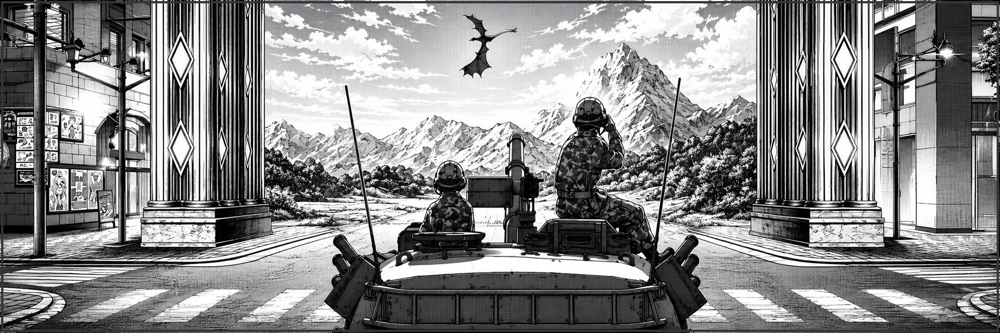
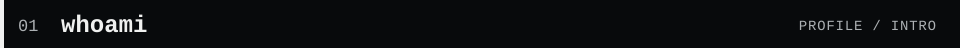
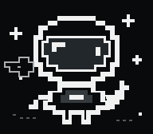
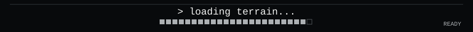
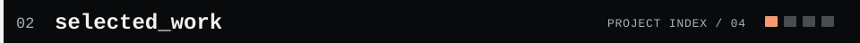
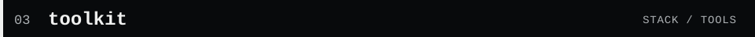
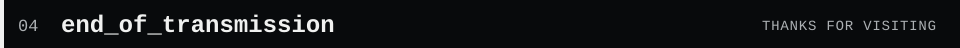
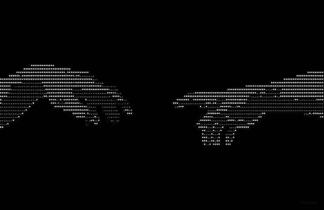

  
  

  <strong>From software to digital worlds.</strong> 
  Aracaju, Brazil · Systems Analysis &amp; Development student

  
  
  
  

I'm a Brazilian software developer and ADS student building independent web products, developer tools and immersive digital worlds. I turn practical problems into reusable software, from interfaces to infrastructure.

My background in the Brazilian Army (28º BC) shapes my approach to discipline, responsibility and teamwork.

**Focus:** full-stack development, automation, application security and product design.

 

  

**PratoBy** is an independent SaaS that helps restaurants operate their own digital ordering channels without marketplace commissions. I build across product, frontend, backend, payments, security and infrastructure.

`React` · `Vite` · `Tailwind CSS` · `Firebase` · `Cloudflare`

[**Explore PratoBy ↗**](https://pratoby.com)

---

### `002` / [HOI4 Map Editor](https://github.com/AdriianCOE/HOI4-Map-Editor)

**Desktop software &amp; data integrity.** Visual province and state editing for Hearts of Iron IV, with project validation, backups and rollback.

`Rust` · `Desktop tooling`

[Source](https://github.com/AdriianCOE/HOI4-Map-Editor) · [Releases](https://github.com/AdriianCOE/HOI4-Map-Editor/releases)

Extends <a href="https://github.com/ScottyThePilot/hoi4_province_editor">ScottyThePilot's province editor</a>.

 

### `003` / [NoronhaMapExporter](https://github.com/AdriianCOE/NoronhaMapExporter)

**Automation &amp; image processing.** Native DayZ map capture and stitching pipeline. A documented export combines **60 captures** into a **9,600 × 9,600 px** image.

`Python` · `PowerShell` · `.NET`

[Source](https://github.com/AdriianCOE/NoronhaMapExporter) · [Releases](https://github.com/AdriianCOE/NoronhaMapExporter/releases) · [Live map ↗](https://adriiancoe.github.io/NoronhaMapExporter/)

 

### `004` / [Fernando de Noronha](https://github.com/AdriianCOE/Noronha)

**Game development &amp; terrain design.** Brazilian-inspired tropical survival world for DayZ on a **10.24 × 10.24 km** terrain, combining environment design, game systems and worldbuilding.

`DayZ Workbench` · `Enfusion Script` · `Blender`

[Repository](https://github.com/AdriianCOE/Noronha) · [Steam Workshop ↗](https://steamcommunity.com/sharedfiles/filedetails/?id=3682451894)

Work in progress.

 

**Web &amp; product**

  
  
  
  
  

**Software &amp; automation**

  
  
  
  

**Game development**

  
  
  
  
  

  

  <a href="https://www.linkedin.com/in/adrian-costaramos/">LinkedIn</a> ·
  <a href="mailto:tommycramos@gmail.com">Email</a> ·
  <a href="https://ko-fi.com/M5U123Y4S4">Support my work</a>

   
  <i>“Live to fight another day, boys.”</i> — Hardcase

