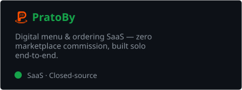

  

  <h1>Adrian Costa</h1>
  
<strong>Software Developer · Independent Product Builder · ADS Student</strong>

  
Building web products, developer tools, and digital worlds.

  
Aracaju, Sergipe · Brazil

  
  
  
  

## About me

I'm a Brazilian software developer and Systems Analysis and Development student interested in the intersection of software engineering, product development, and game tooling.

I build products end to end, from the interface to backend services and infrastructure. I also develop tools for game modding communities, turning problems I encounter in my own projects into solutions others can use.

My background in the Brazilian Army (28º BC) informs how I approach responsibility, discipline, and teamwork.

**Current focus:** full-stack development, application security, reliable tooling, and digital product design.

 

## Featured product

<table>
  <tr>
    <td width="40%" valign="middle" align="center">
      
    </td>
    <td valign="top">
      <h3>PratoBy</h3>
      
<strong>Independent digital ordering SaaS for restaurants</strong>

      
Built to help restaurants operate their own digital ordering channels without marketplace commissions.

      
<strong>My role:</strong> end-to-end product development across the frontend, backend, payment integration, security, and infrastructure.

      
<code>React</code> <code>Vite</code> <code>Tailwind CSS</code> <code>Firebase</code> <code>Cloudflare</code>

      <a href="https://pratoby.com"><strong>Visit PratoBy ↗</strong></a>
    </td>
  </tr>
</table>

## Selected projects

### Developer tools

**[HOI4 Map Editor](https://github.com/AdriianCOE/HOI4-Map-Editor)** — Desktop tooling for Hearts of Iron IV mod developers

An extension of [ScottyThePilot's province editor](https://github.com/ScottyThePilot/hoi4_province_editor), with visual state editing, multiple map views, validation, and a coordinated save workflow designed to recover from failures through backups and rollback.

`Rust` · `Desktop applications` · `Data validation` · `File integrity`

[Source code](https://github.com/AdriianCOE/HOI4-Map-Editor) · [Releases](https://github.com/AdriianCOE/HOI4-Map-Editor/releases)

**[NoronhaMapExporter](https://github.com/AdriianCOE/NoronhaMapExporter)** — Native map export and image-processing pipeline for DayZ

An MIT-licensed tool that automates map capture and image stitching for compatible vanilla and custom terrains. One documented output is a **9,600 × 9,600 px** map assembled from **60 native captures**.

`Python` · `PowerShell` · `.NET` · `Image processing` · `Automation`

[Source code](https://github.com/AdriianCOE/NoronhaMapExporter) · [Releases](https://github.com/AdriianCOE/NoronhaMapExporter/releases) · [Interactive map ↗](https://adriiancoe.github.io/NoronhaMapExporter/)

### Game development & worldbuilding

**[Fernando de Noronha](https://github.com/AdriianCOE/Noronha)** — Brazilian survival terrain for DayZ

A tropical game world inspired by the Fernando de Noronha archipelago, built on a 10.24 × 10.24 km terrain. The project combines geographic references, terrain design, game-system configuration, and open-world optimization. Currently in development.

`DayZ Workbench` · `Terrain Builder` · `Enfusion Script` · `Blender`

[Repository](https://github.com/AdriianCOE/Noronha) · [Steam Workshop ↗](https://steamcommunity.com/sharedfiles/filedetails/?id=3682451894)

**[Empires of Azarya](https://github.com/AdriianCOE/Azarya)** — Total conversion mod for Hearts of Iron IV

An original fictional universe expressed through nations, conflicts, narrative events, campaigns, and custom game systems. A long-form project combining systems design, scripting, interface customization, and worldbuilding.

`Paradox Script` · `GUI Modding` · `Game Design` · `Worldbuilding`

[Repository](https://github.com/AdriianCOE/Azarya) · [Steam Workshop ↗](https://steamcommunity.com/sharedfiles/filedetails/?id=3505750217)

## Technical toolkit

| Area | Technologies & tools |
| :--- | :--- |
| Web development | `React` · `Vite` · `Tailwind CSS` |
| Backend & infrastructure | `Firebase` · `Cloudflare` |
| Software & automation | `Rust` · `Python` · `PowerShell` · `.NET` |
| Game tooling & 3D | `DayZ Workbench` · `Terrain Builder` · `Blender` · `Enfusion Script` · `Paradox Script` |
| Engineering interests | Application security · data integrity · automation · product design |

## GitHub activity

  

## Get in touch

Interested in software development, independent products, or game tooling? Feel free to reach out.

[LinkedIn](https://www.linkedin.com/in/adrian-costaramos/) · [Email](mailto:tommycramos@gmail.com) · [PratoBy](https://pratoby.com) · [Support my projects on Ko-fi](https://ko-fi.com/M5U123Y4S4)

  
  
<em>“Live to fight another day, boys.”</em> — <strong>Hardcase</strong>

  

