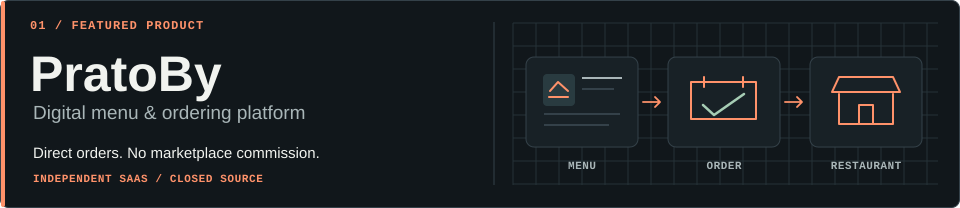
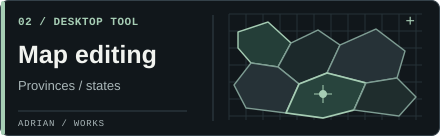
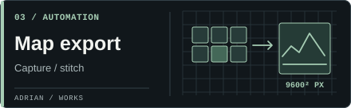
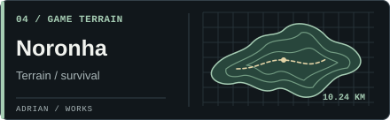
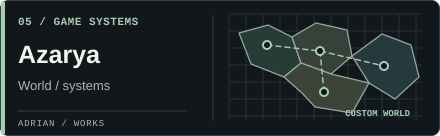

  
  

  <a href="https://pratoby.com"><strong>PratoBy ↗</strong></a> &nbsp; / &nbsp;
  <a href="https://www.linkedin.com/in/adrian-costaramos/">LinkedIn</a> &nbsp; / &nbsp;
  <a href="mailto:tommycramos@gmail.com">Email</a> &nbsp; / &nbsp;
  <a href="https://github.com/AdriianCOE?tab=repositories">Repositories</a>

I build web products, developer tools and digital worlds. My work spans full-stack development, automation and game systems, with an emphasis on solving practical problems and building things people can use.

My Brazilian Army background (28º BC) shapes my approach to discipline, responsibility and teamwork.

 

## Featured product

**PratoBy** is an independent SaaS that helps restaurants run their own digital ordering channels without marketplace commissions.

I work across the product, frontend, backend, payments, application security and infrastructure.

`React` · `Vite` · `Tailwind CSS` · `Firebase` · `Cloudflare`

[**Visit PratoBy ↗**](https://pratoby.com)

## Selected work

<table width="100%">
  <tr>
    <td width="50%" valign="top">
      
      <h3><a href="https://github.com/AdriianCOE/HOI4-Map-Editor">HOI4 Map Editor</a></h3>
      
Visual province and state editor for Hearts of Iron IV, with project validation, backups and rollback.

      
<code>Rust</code> · <code>Desktop tooling</code>

      
<a href="https://github.com/AdriianCOE/HOI4-Map-Editor">Source</a> · <a href="https://github.com/AdriianCOE/HOI4-Map-Editor/releases">Releases</a>

      Extends <a href="https://github.com/ScottyThePilot/hoi4_province_editor">ScottyThePilot's province editor</a>.
    </td>
    <td width="50%" valign="top">
      
      <h3><a href="https://github.com/AdriianCOE/NoronhaMapExporter">NoronhaMapExporter</a></h3>
      
Automates native DayZ map capture and image stitching. A documented export combines 60 captures into a <strong>9,600 × 9,600 px</strong> image.

      
<code>Python</code> · <code>PowerShell</code> · <code>.NET</code>

      
<a href="https://github.com/AdriianCOE/NoronhaMapExporter">Source</a> · <a href="https://adriiancoe.github.io/NoronhaMapExporter/">Live map ↗</a>

      MIT-licensed developer tool.
    </td>
  </tr>
  <tr>
    <td width="50%" valign="top">
      
      <h3><a href="https://github.com/AdriianCOE/Noronha">Fernando de Noronha</a></h3>
      
A Brazilian-inspired tropical survival world for DayZ, combining terrain design, game systems and open-world optimization on a <strong>10.24 × 10.24 km</strong> terrain.

      
<code>DayZ Workbench</code> · <code>Enfusion Script</code> · <code>Blender</code>

      
<a href="https://github.com/AdriianCOE/Noronha">Repository</a> · <a href="https://steamcommunity.com/sharedfiles/filedetails/?id=3682451894">Workshop ↗</a>

      Work in progress.
    </td>
    <td width="50%" valign="top">
      
      <h3><a href="https://github.com/AdriianCOE/Azarya">Empires of Azarya</a></h3>
      
An original fictional universe built as a total conversion for Hearts of Iron IV, with nations, events, campaigns and custom game systems.

      
<code>Paradox Script</code> · <code>GUI modding</code> · <code>Game design</code>

      
<a href="https://github.com/AdriianCOE/Azarya">Repository</a> · <a href="https://steamcommunity.com/sharedfiles/filedetails/?id=3505750217">Workshop ↗</a>

      Worldbuilding through game development.
    </td>
  </tr>
</table>

## Technical toolkit

**Web & product** &nbsp; React · Vite · Tailwind CSS · Firebase · Cloudflare

**Software & automation** &nbsp; Rust · Python · PowerShell · .NET

**Game development** &nbsp; DayZ Workbench · Terrain Builder · Enfusion Script · Blender · Paradox Script

**Engineering interests** &nbsp; Application security · data integrity · automation · product design

---

  <a href="https://www.linkedin.com/in/adrian-costaramos/">Let's connect on LinkedIn</a> &nbsp;·&nbsp;
  <a href="mailto:tommycramos@gmail.com">Email me</a> &nbsp;·&nbsp;
  <a href="https://ko-fi.com/M5U123Y4S4">Support my work</a>

   
  <i>“Live to fight another day, boys.”</i> — Hardcase

