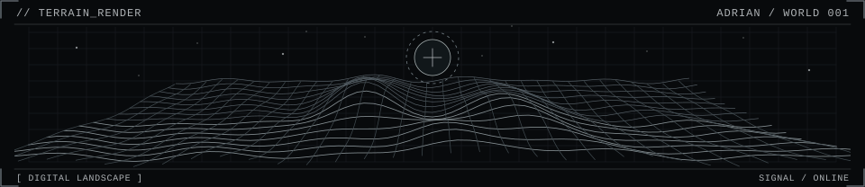
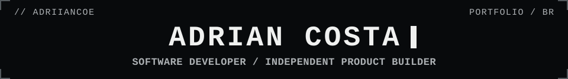
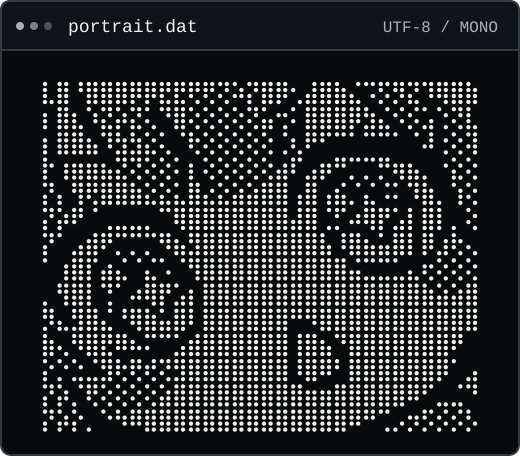
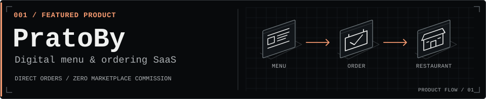
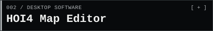
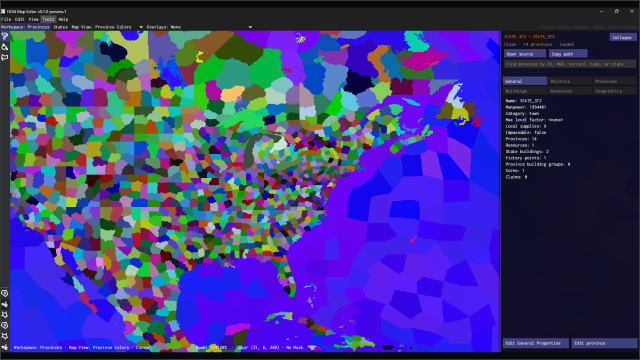
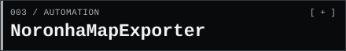
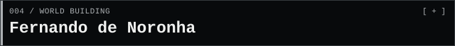
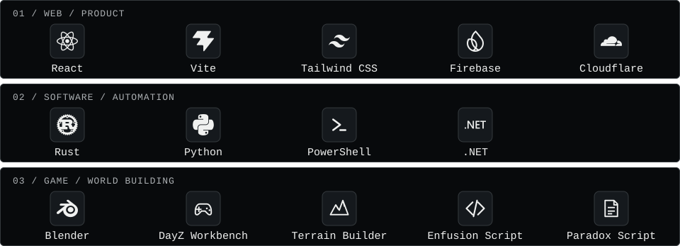
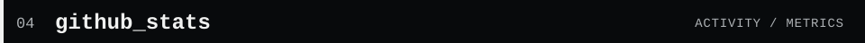

  
  

  <strong>From software to digital worlds.</strong> 
  Aracaju, Brazil · Systems Analysis &amp; Development student

  
  
  
  

I'm a Brazilian software developer and ADS student building independent web products, developer tools and immersive digital worlds. I turn practical problems into reusable software, from interfaces to infrastructure.

My background in the Brazilian Army (28º BC) shapes my approach to discipline, responsibility and teamwork.

**Focus:** full-stack development, automation, application security and product design.

 

  

**PratoBy** is an independent SaaS that helps restaurants operate their own digital ordering channels without marketplace commissions. I build across product, frontend, backend, payments, security and infrastructure.

`React` · `Vite` · `Tailwind CSS` · `Firebase` · `Cloudflare`

[**Explore PratoBy**](https://pratoby.com)

---

<table width="100%">
  <tr>
    <td width="50%" valign="top">
      

      

      
Visual province and state editing for Hearts of Iron IV, with project validation, backups and rollback.

      
<code>Rust</code> · <code>Desktop tooling</code>

      
 

      Extends <a href="https://github.com/ScottyThePilot/hoi4_province_editor">ScottyThePilot's province editor</a>.
    </td>
    <td width="50%" valign="top">
      

      

      
Native DayZ map capture and stitching. A documented export combines <strong>60 captures</strong> into a <strong>9,600 × 9,600 px</strong> image.

      
<code>Python</code> · <code>PowerShell</code> · <code>.NET</code>

      
  

      Image processing &amp; automation.
    </td>
  </tr>
  <tr>
    <td colspan="2" valign="top">
      

      
      
Brazilian-inspired tropical survival world for DayZ on a <strong>10.24 × 10.24 km</strong> terrain, combining environment design, game systems and worldbuilding.

      
<code>DayZ Workbench</code> · <code>Enfusion Script</code> · <code>Blender</code>

      
 

      Work in progress.
    </td>
  </tr>
</table>

  

<table align="center">
  <tr>
    <td align="center">
      
    </td>
    <td align="center">
      
    </td>
  </tr>
</table>

  

<code>END_OF_TRANSMISSION_</code>

  <a href="https://www.linkedin.com/in/adrian-costaramos/">LinkedIn</a> ·
  <a href="mailto:tommycramos@gmail.com">Email</a> ·
  <a href="https://ko-fi.com/M5U123Y4S4">Support my work</a>

   
  <i>“Live to fight another day, boys.”</i> — Hardcase

